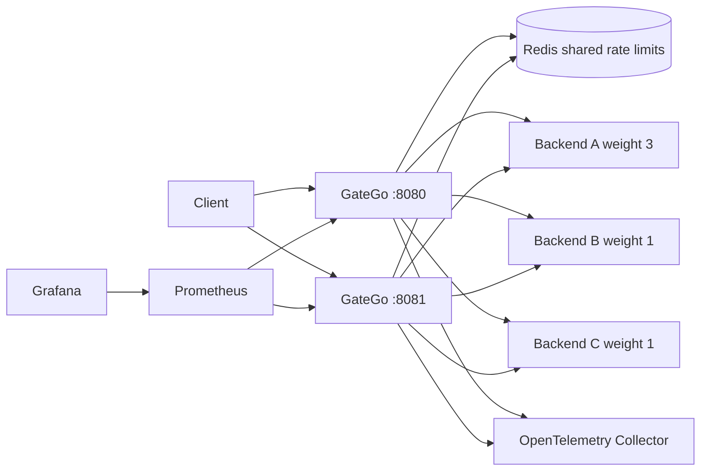

# GateGo

GateGo is a resilient Go API gateway that keeps traffic flowing when an upstream fails. It combines weighted load balancing, active health checks, bounded retries, circuit breakers, JWT authentication, shared Redis rate limiting, graceful draining, metrics, traces, and atomic configuration reloads.



## See it work

Prerequisites: Go, Docker with Compose, `curl`, and `make`.

```bash
make demo
```

The demo builds the complete two-gateway topology, waits for readiness, calls public and JWT-protected routes, prints a metrics sample, forces backend B to return `503`, and shows B's circuit opening while requests continue through A and C. The stack remains available for inspection; stop it with `make compose-down`.

Generate a repeatable failure matrix and Markdown evidence report with:

```bash
make chaos-report
```

This tests backend latency, persistent 503 responses, a stopped backend process, Redis interruption, and full recovery. See [the chaos testing guide](docs/CHAOS_TESTING.md) for report contents and parameters.

On Windows without `make`, run:

```powershell
./scripts/smoke.ps1
```

## Why these choices

| Choice | Why | Trade-off |
|---|---|---|
| Go and mostly its standard library | Small binaries, explicit concurrency, and a network stack suitable for a gateway hot path | More infrastructure code is implemented directly |
| Two gateway replicas with Redis | Demonstrates horizontal scaling while enforcing one global rate-limit bucket | Redis failure falls back to locally consistent limits |
| Weighted round robin | Predictable traffic allocation that is easy to inspect and test | It does not automatically account for backend latency |
| Health checks plus circuit breakers | Health checks detect readiness proactively; circuits react immediately to real request failures | Two independent state signals must be understood operationally |
| Retry budgets and backend bulkheads | Prevent one failed replica from amplifying load into healthy replicas | Overload is rejected deliberately instead of queued indefinitely |
| Atomic JSON reloads | Invalid configuration never replaces the last-known-good route set | This is not a distributed control plane |
| Prometheus and OpenTelemetry | Metrics explain aggregate behavior while traces explain individual requests | Full observability adds three demo containers |
| Multi-stage container builds | The compiler stays out of the runtime image, reducing size and attack surface | Builds have an additional stage |

Retries are contained by per-route concurrency budgets and each backend has an independent bulkhead. Circuit thresholds, cooldowns, bulkhead capacity, and retry capacity are configurable per route through the `resilience` object.

## Run locally

Start three demo backends, then GateGo with the local configuration:

```powershell
go run ./cmd/demo-backend -name backend-a -port 9001
go run ./cmd/demo-backend -name backend-b -port 9002
go run ./cmd/demo-backend -name backend-c -port 9003
go run ./cmd/gatego -config configs/gatego.local.json
```

Or run the horizontally scaled topology with Docker Compose:

```powershell
docker compose up -d --build
```

GateGo #1 listens on port 8080 and GateGo #2 on port 8081. Both use the same Redis instance, so `/global-limit` has one global token bucket rather than a separate allowance per gateway.

Prometheus and Grafana are available with the observability profile. The OpenTelemetry Collector receives OTLP/HTTP traces and prints a basic export summary:

```powershell
docker compose --profile observability up -d --build
docker compose logs -f otel-collector
```

Prometheus is exposed on port 9090 and Grafana on port 3000. Outside Compose, set `OTEL_EXPORTER_OTLP_ENDPOINT` to enable trace export; W3C trace-context propagation remains active when export is disabled.

## Configuration and service discovery

Backends are addressed by DNS names in `configs/gatego.json`; Docker, Kubernetes, or another service registry supplies the current endpoint behind each name. GateGo also polls its mounted configuration file every `server.config_reload_interval` and atomically activates valid changes. A malformed update leaves the last known-good routes active.

Reloads can also be triggered with `SIGHUP` or:

```powershell
Invoke-WebRequest -Method Post -Headers @{"X-Admin-Key"="dev-admin-key"} http://localhost:8080/admin/reload
```

A candidate configuration can be validated without applying it:

```powershell
Invoke-WebRequest -Method Post -Headers @{"X-Admin-Key"="dev-admin-key"} -ContentType "application/json" -InFile configs/gatego.json http://localhost:8080/admin/config/validate
```

Authenticated `GET /admin/backends` reports health and circuit state for every route/backend pair.

Operators can manually clear circuit state after an emergency repair. The route is required; `backend` may be either the backend URL or host and can be omitted to reset every backend on the route:

```powershell
Invoke-WebRequest -Method Post -Headers @{"X-Admin-Key"="dev-admin-key"} "http://localhost:8080/admin/circuits/reset?route=public-api&backend=backend-b:9002"
```

`GET /readyz` is circuit-aware: it returns unavailable when any configured route has no healthy, circuit-eligible backend.

Backends can be drained before maintenance without interrupting requests already in flight. `POST` begins draining and `DELETE` makes the backend eligible for new traffic again:

```powershell
Invoke-WebRequest -Method Post -Headers @{"X-Admin-Key"="dev-admin-key"} "http://localhost:8080/admin/backends/drain?route=public-api&backend=backend-b:9002"
Invoke-WebRequest -Method Delete -Headers @{"X-Admin-Key"="dev-admin-key"} "http://localhost:8080/admin/backends/drain?route=public-api&backend=backend-b:9002"
```

## Verification

```powershell
go test ./... -count=1
go test ./internal/... -count=1
go test ./integration -count=1
./scripts/resilience.ps1
./scripts/benchmark.ps1
```

Tests under `internal/` are focused unit and component tests. Tests under `integration/` start real HTTP listeners for GateGo and its backends and exercise administrative operations, routing, readiness, and metrics through the network boundary. The complete Go suite also includes deterministic retry, failure, slow-upstream, circuit-breaker, graceful-shutdown, distributed Redis limit, and config-reload coverage. The resilience script repeats failure scenarios against real containers; it requires Docker Desktop or another running Docker daemon.

The demo backend exposes an authenticated fault controller for testing:

```text
POST   /admin/fault?status=503&delay=2s&healthy=false
DELETE /admin/fault
X-Admin-Key: demo-admin-key
```

Measured throughput and latency results, the saturation point, topology, and methodology are in [BENCHMARKS.md](BENCHMARKS.md).
